# 样衣选品 PRD

| 文档信息 | 内容 |
| --- | --- |
| 文档版本 / 状态 | v0.7 / 已同步新版 Demo；分析交互可评审，正式统计数据规则待确认 |
| 本次范围 | 方案录入、订单生成中的方案保存、两端方案查看与复制、修改内容配置、数据分析 |
| 需求来源 | 用户已确认需求；当前样衣 Demo；`analytics.html`、`analytics.js`、`mobile.html` 及订单查看页面；本轮已确认讨论 |
| 模板 | cr-prd brief@1.3 |

**本次修改点（v0.7）**

| 修改范围 | 本次调整 |
| --- | --- |
| 颜色录入 | 保留简洁列表，展示每条颜色的色位数、件数；新增全部颜色明细及进入单条调整的规则 |
| 选款分析 | 三项指标统一为选中次数、二次打样次数、下单数；三条趋势线同时展示，排行与汇总独立切换 |
| 修改分析 | 集中承接修改分布与排行；保留选款汇总的修改内容数量入口，支持直接筛选单个客户 |
| 颜色分析 | 替代“选料分析”名称，明确原料、颜色编码、组合与件数的统计关系 |
| 筛选与跳转 | 筛选保持一行；款式、品类、客户汇总统一支持跳转，条件回显到顶部并可继续调整 |
| 配图与验收 | 更新录入、订单查看及分析截图，补充验收；修正 REQ-012/013 锚点和旧验收编号归属 |

## 1. 背景与目标

业务员接待客户时，需要记录客户选择的样衣，以及每件样衣对应方案的修改内容、颜色、尺码和其他资料。接待结束后，业务员查看订单，将相关需求人工录入 ERP，供后续业务处理使用。管理人员负责维护录入时使用的配置。

本期目标是让接待过程中的需求有清晰、统一的记录方式，让业务员能够按客户、样衣和方案查看已记录内容，减少后续整理和转录时的信息遗漏。

**未来规划：**后续考虑与 ERP 等业务系统进行数据对接。系统对接不属于本期开发内容，本期以业务员查看订单并人工录入 ERP 为使用场景。

## 2. 范围与使用场景

| 角色 | 使用场景 | 要完成的任务 |
| --- | --- | --- |
| 业务员 | 接待客户，沟通样衣需求 | 通过炫款小程序记录客户、所选样衣及每个方案的修改内容、颜色、尺码和资料 |
| 业务员 | 接待后整理需求，录入 ERP | 通过炫款小程序端或 PC 端查看订单和方案，预览图片，复制修改内容 |
| 管理人员 | 维护录入基础选项 | 维护修改类别与标签 |
| 现有分析功能使用人员 | 复盘客户选款与修改、原料颜色使用情况 | 按周期、品类、款式、客户筛选，查看趋势、排行、汇总及关联分析；访问权限沿用已有系统 |

客户信息及选品基础流程沿用已有系统逻辑，客户字段及必填规则由现有配置决定。

本期包含上述主流程及选款分析、修改分析、颜色分析三个独立入口。页面展示、筛选、模块切换和跳转规则已确认；正式数据来源、统计触发时点等未确定事项集中列在第 4 节末，不以 Demo 示例数据代替。

## 3. 业务流程

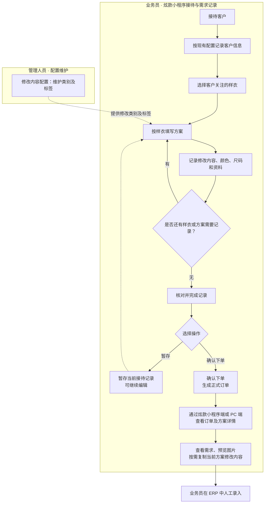

图中实线表示业务步骤，虚线表示配置支持或过程回到编辑。点击“暂存”只保存当前接待过程，不生成正式订单；点击“确认下单”才生成正式订单，之后可在炫款小程序端和 PC 端查看。ERP 录入为业务员在外部系统中的人工操作，本期不自动传送数据。

数据分析不作为接待录入的前置步骤。使用人员可直接进入任一分析页，也可从选款汇总进入指定对象的修改分析或颜色分析：

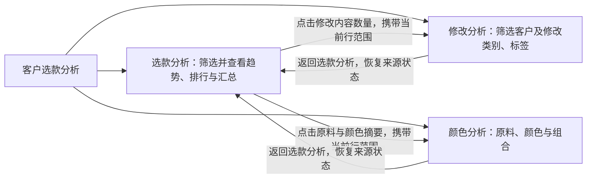

统计数据如何纳入上述分析仍须按第 4 节末的待确认事项确定。

对象关系：一份选品记录包含所选样衣，每件样衣下记录方案，每个方案包含修改内容、颜色、尺码和资料。这里的“订单”指点击“确认下单”后生成的正式业务记录；“暂存”记录不属于正式订单。

## 4. 功能需求

### 4.1 功能清单

| 功能编号 | 模块 | 功能名称 | 简述 |
| --- | --- | --- | --- |
| [REQ-001](#req-001) | 小程序-代客选品 | 方案录入 | 按样衣组织多个方案，以三个模块记录需求 |
| [REQ-002](#req-002) | 小程序-代客选品 | 修改内容 | 按类别、标签记录修改文字及附图 |
| [REQ-003](#req-003) | 小程序-代客选品 | 颜色 | 记录颜色件数及各色位的原料、颜色编码 |
| [REQ-004](#req-004) | 小程序-代客选品 | 方案资料 | 记录款式说明、针种、季节、尺码、备注及图片 |
| [REQ-005](#req-005) | 小程序-代客选品 | 订单生成 | 确认下单时保存各样衣的方案及完整内容 |
| [REQ-006](#req-006) | 小程序-选样订单 | 方案查看 | 在订单列表和详情中查看方案摘要、三个模块及图片 |
| [REQ-007](#req-007) | 小程序-选样订单 | 复制修改内容 | 在订单列表和方案详情中复制当前方案的修改文字 |
| [REQ-008](#req-008) | PC端-选样订单 | 方案查看 | 在订单表格和侧边详情中查看方案摘要、三个模块及图片 |
| [REQ-009](#req-009) | PC端-选样订单 | 复制修改内容 | 在订单表格和侧边详情中复制当前方案的修改文字 |
| [REQ-010](#req-010) | PC端-配置管理-修改内容 | 修改内容配置 | 管理修改类别及标签，供修改内容录入选择 |
| [REQ-011](#req-011) | PC端-客户选款分析 | 选款分析 | 三项指标、同步趋势、独立排行与汇总，支持关联分析跳转 |
| [REQ-012](#req-012) | PC端-客户选款分析 | 修改分析 | 按客户等范围分析修改类别、标签、数量与分布 |
| [REQ-013](#req-013) | PC端-客户选款分析 | 颜色分析 | 按原料、颜色编码及组合分析使用件数和次数 |

### 4.2 功能详细说明

界面截图来自当前样衣 Demo，按功能附图并标注关键位置；业务规则以正文为准。

**通用输入规则**

| 项目 | 限制 |
| --- | --- |
| 业务文字 | 每个字段最多 100 字，字符计数方式沿用现有规范 |
| 图片数量 | 每个上传位置最多 6 张；单条修改项附图与单个方案资料图片分别计数 |
| 图片大小 | 单张最大 50 MB |
| 业务数量 | 除图片张数外，方案、颜色、色位及件数等不设业务上限 |
| 格式与异常提示 | 图片格式、上传失败、文字超长、图片超限等沿用系统通用规则 |

默认值列中“—”表示未单独约定；必填列中“—”表示不适用。页面字段名沿用界面文案；数量计算统一使用“颜色件数、方案件数、样衣数量、订单总数量”。下文“资料”模块均指方案资料。

**通用编辑规则**

适用于所有新增、编辑页面。是否存在未保存修改，以进入页面或最近一次点击“完成”后的内容为准；系统提供的初始值不算用户修改。

| 操作 | 条件 | 结果 |
| --- | --- | --- |
| 完成 | 校验通过 | 保存当前内容，更新对应摘要、列表及数量汇总 |
| 返回（包括页面返回入口、移动端左移返回） | 无未保存修改 | 直接返回 |
| 返回 | 有未保存修改 | 二次确认是否放弃修改 |
| 取消退出 | 已出现返回确认 | 留在页面，保留当前输入 |
| 确认退出 | 已出现返回确认 | 丢弃未保存修改；未保存的新增记录不创建，已有记录保留上次保存内容 |
| 删除 | 点击删除入口 | 二次确认；确认后仅删除目标及其所属内容，取消则不变 |

返回不等于保存。子页面点击“完成”后，内容保持已保存状态，不因上级页面放弃其他未保存修改而撤销。摘要、列表和数量汇总须与保存结果一致，不保留已丢弃的修改。

例如：新建方案后，仅完成一条颜色，再返回退出方案页，保留该方案及已保存颜色；方案页其他未保存输入丢弃。

<a id="req-001"></a>

#### REQ-001 方案录入

同一样衣可新增多个方案，各方案内容独立，不设数量上限。

| 模块 | 录入与展示 |
| --- | --- |
| 修改内容 | 默认显示前两条；超过两条时可展开 / 收起，新增入口保持可见 |
| 颜色 | 紧凑列表展示全部已保存颜色，每条仅显示颜色序号、色位数、件数与进入箭头；保留新增颜色和查看明细入口，单条在独立页面填写 |
| 资料 | 在方案页直接展示和编辑，不设置展开 / 收起 |

方案页固定显示修改内容、颜色、方案资料三个模块，均选填。选择填写某条信息时，按对应模块补全必需字段；资料字段仍全部选填。三个模块全空的方案不保存，任一模块有有效内容即可保存，其他有效方案不受影响。

两条及以下的修改内容不显示展开 / 收起。方案录入的颜色列表不采用前两条折叠；订单查看的折叠规则见 REQ-006、REQ-008。方案删除入口位于编辑页左下角，确认后删除当前方案及其内容，并更新所属样衣的展示。保存、返回与删除遵循通用编辑规则。

- 验收 AC-001-1：四条修改内容默认显示两条，可展开全部并收起；仅一条时无展开按钮。
- 验收 AC-001-7：四条颜色在方案页显示四行，每行含色位数和件数；可通过“查看明细”查看全部颜色，不增加原料或编码长摘要。
- 验收 AC-001-2：编辑一个方案不改变同一样衣下其他方案的内容。
- 验收 AC-001-4：删除方案时取消确认，内容不变；确认删除后仅移除目标方案及其内容，其他方案保留。
- 验收 AC-001-5：所有新增、编辑页面无未保存修改时返回不弹窗；存在未保存修改时返回须确认。取消退出保留当前输入，确认退出丢弃未保存修改，已有记录及其摘要恢复至上次保存内容。
- 验收 AC-001-6：全空方案不保存；仅填写有效修改内容、颜色、尺码或任一资料字段的方案可保存。

**界面参考：方案录入**

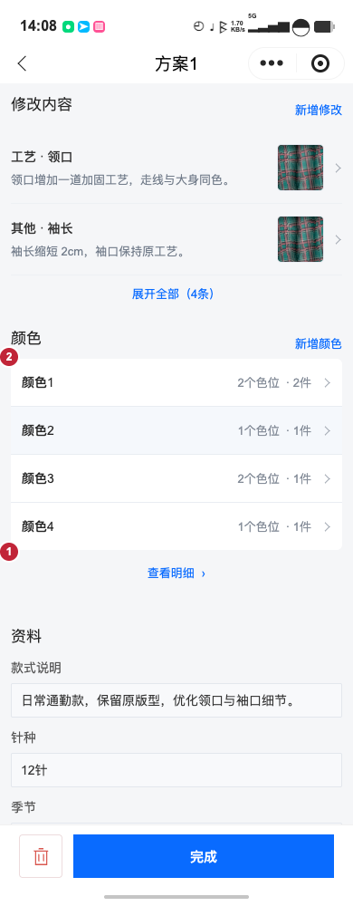

① 查看明细入口；② 简洁颜色列表，显示色位数与件数。截图为方案页首屏，资料在下方直接编辑。

来源：样衣 Demo `mobile.html`，方案录入页面。

<a id="req-002"></a>

#### REQ-002 修改内容

每条修改要求支持新增、编辑、删除。

| 字段 | 录入方式 | 必填 | 默认值 | 规则 |
| --- | --- | --- | --- | --- |
| 类别 | 选择配置项 | 是 | — | 当前包括工艺、面料、其他，由配置维护 |
| 标签 | 选择配置项 | 否 | — | 使用所属类别下的标签 |
| 修改文字 | 文本输入 | 是 | — | 最多 100 字 |
| 附图 | 图片上传 | 否 | — | 每条最多 6 张，单张最大 50 MB，支持预览 |

类别或修改文字缺失时不能完成。附图归属于当前修改项，与方案资料图片分别记录。保存、返回与删除遵循通用编辑规则。

- 验收 AC-002-2：删除一条修改项，不影响其他修改项及其附图。

<a id="req-003"></a>

#### REQ-003 颜色

这里的一条“颜色”是方案内的一套配色记录，包含对应件数及多个色位；不等同于一个颜色编码。业务员从方案颜色模块新增或打开一条颜色记录，在独立页面填写。颜色模块整体选填；填写一条颜色时，下列信息须完整。

| 字段 | 录入方式 | 必填 | 默认值 | 规则 |
| --- | --- | --- | --- | --- |
| 数量（颜色件数） | 整数输入 | 是 | — | 至少 1 件，不设业务上限 |
| 色位 | 系统分配标识 | 是 | 首个为 A；新增取下一个未使用标识 | 至少保留一个色位 |
| 原料 | 文本输入 | 是 | 首行为空；新增行复制上一行 | 最多 100 字，各行独立编辑 |
| 颜色编码 | 文本输入 | 是 | 空 | 最多 100 字；允许重复，包括同一颜色的不同色位 |

- 色位依次使用 A～Z、AA～AZ、BA～BZ……，超过 ZZ 后继续使用 AAA、AAB……，不设数量上限。
- 必填字段仅有空白字符时视为未填写。点击“完成”校验全部必填项；缺项时停留在编辑页，提示并定位首个缺失字段。
- 颜色模块内不能只填件数而不填颜色信息；颜色模块整体未填写时，允许在外层填写样衣件数并下单。
- 摘要仅显示颜色序号、色位数和数量，例如“颜色1  2个色位 · 2件”，点击后查看和编辑。
- 删除入口位于颜色编辑页左下角。保存、返回与删除遵循通用编辑规则；尚未点击“完成”的内容不纳入暂存。

**全部颜色明细与单条调整**

- “查看明细”打开当前方案的全部颜色记录，按颜色序号展示，支持滚动查看。
- 每条展示色位数、对应件数，并以“色位｜原料｜颜色编码”表格列出全部色位；不合并不同颜色记录。
- 点击某条颜色进入现有单条颜色编辑页。从明细进入时，完成或按通用编辑规则放弃修改后返回明细；从方案列表进入时返回方案页。返回恢复来源滚动位置。
- 完成后明细及方案摘要同步显示保存结果，相关数量按下述规则更新；取消放弃操作时保留编辑页输入。无颜色时明细展示空状态，不生成默认记录。

**数量计算**

| 对象 | 计算规则 | 手动修改 |
| --- | --- | --- |
| 方案件数 | 当前方案各颜色件数之和 | 通过修改颜色件数调整 |
| 样衣数量 | 默认取当前样衣各方案件数之和 | 允许；不反向修改方案或颜色件数 |
| 订单总数量 | 各样衣当前数量之和 | 不允许 |

后续操作使当前样衣的方案件数合计发生变化时，重新计算并覆盖手动填写的样衣数量，订单总数量同步更新。例如，增删有件数的颜色或方案、修改颜色件数。仅修改文字、尺码或资料，以及增删不含颜色件数的方案，不触发数量覆盖。

- 验收 AC-003-1：A 行原料为棉，新增 B 行时原料为棉、编码为空；修改 B 原料不会改变 A。
- 验收 AC-003-5：颜色点击“完成”后返回上级，再返回时仍保留已保存颜色；通过右上角返回或移动端左移返回，均按有无未保存修改决定是否弹出确认，不将返回视为保存。
- 验收 AC-003-6：颜色模块内部仅填写件数而未补全颜色信息时，不能完成该条记录；颜色模块未填写、仅外层样衣填写件数时允许下单。
- 验收 AC-003-8：样衣的两个方案分别为 2 件、3 件时，样衣数量默认 5 件且可手动修改；改为 6 件后，方案件数仍为 2 件、3 件。另一件样衣为 4 件时，订单总数量为 10 件且不可手动修改；随后将原方案的 3 件改为 5 件，样衣数量重新累计为 7 件，覆盖手动值 6 件，订单总数量为 11 件。

- 验收 AC-003-9：当前方案有四条颜色，明细显示四条各自的数量与色位表格；点击第三条进入第三条编辑页，完成后回到明细原位置，第三条内容更新，其他记录不变。
- 验收 AC-003-10：从明细编辑后放弃未保存修改，返回明细且保留上次保存结果；取消放弃则留在编辑页。从方案列表进入编辑后返回方案列表。

**界面参考：全部颜色明细**

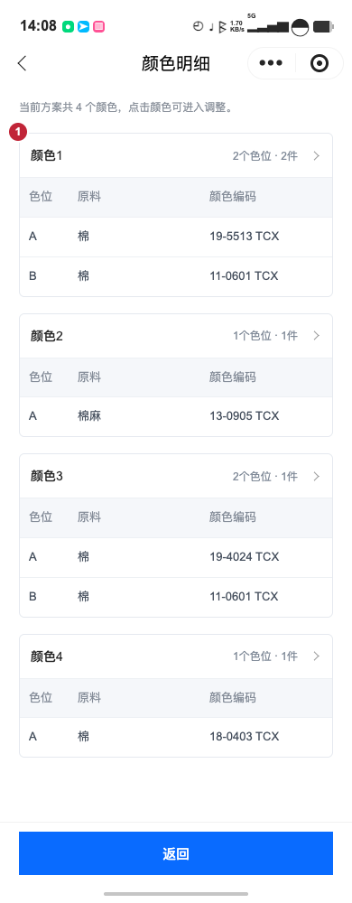

① 点击颜色标题行进入单条调整；各颜色分别展示数量和色位表格。

来源：样衣 Demo `mobile.html`，方案录入 → 查看明细。

**界面参考：颜色编辑**

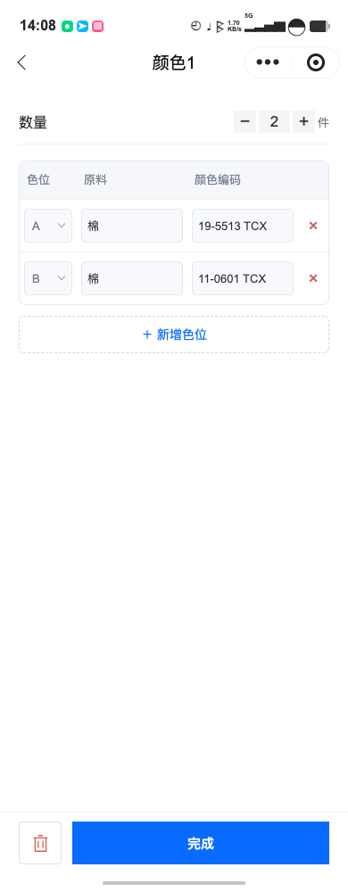

上方填写颜色件数，中间编辑色位、原料与颜色编码；左下角删除，底部“完成”保存当前颜色。

来源：样衣 Demo `mobile.html`，颜色编辑页面。

<a id="req-004"></a>

#### REQ-004 方案资料

资料在方案页直接展示和编辑，各字段均选填，可只填写任意一项。

| 字段 | 录入方式 | 必填 | 默认值 | 规则 |
| --- | --- | --- | --- | --- |
| 款式说明 | 文本输入 | 否 | — | 最多 100 字 |
| 针种 | 文本输入 | 否 | — | 最多 100 字 |
| 季节 | 文本输入 | 否 | — | 最多 100 字 |
| 尺码 | 文本输入 | 否 | — | 最多 100 字 |
| 方案备注 | 多行文本输入 | 否 | — | 最多 100 字 |
| 方案图片 | 多图上传，支持预览 | 否 | — | 最多 6 张，单张最大 50 MB |

资料按方案分别保存。方案图片与修改项附图分别归属，不相互替代。

- 验收 AC-004-3：仅填写备注或仅上传方案图片时可完成，其他资料字段不触发必填校验。

<a id="req-005"></a>

#### REQ-005 订单生成（小程序-代客选品）

在已有下单功能上增加方案数据保存，暂存和确认下单流程沿用现有功能。

| 保存内容 | 字段 |
| --- | --- |
| 修改内容 | 类别、标签、文字、附图 |
| 颜色 | 数量、色位、原料、颜色编码 |
| 方案资料 | 各资料字段、方案图片 |

保存时保留订单、样衣、方案的归属关系，不同方案不合并或覆盖。

| 操作 | 保存与恢复规则 |
| --- | --- |
| 暂存 | 保存当前接待记录中已完成保存的方案内容，范围见上表；不生成正式订单 |
| 恢复暂存 | 恢复各方案的修改内容、颜色、尺码、资料及图片，保留所属样衣 |
| 确认下单 | 将各样衣下已完成保存的全部方案随正式订单保存 |

颜色等子页面点击“完成”后即纳入暂存，无需再点击上级方案页的“完成”。新方案中已完成的颜色等内容同样纳入暂存，即使退出方案页时放弃了其他未保存输入。未完成保存的子页面内容不纳入暂存；上级页面退出时，只按通用编辑规则处理尚未保存的修改。暂存不新增订单状态或审批流程。

- 验收 AC-005-1：同一样衣填写两个不同方案并确认下单后，重新打开订单可分别读取两个方案的完整内容，与下单时一致。
- 验收 AC-005-2：多件样衣及多个方案的内容分别归属，不串数据、不遗漏附图或资料图片。
- 验收 AC-005-3：填写多个方案后暂存并退出，通过现有入口恢复暂存记录，各方案内容、图片及所属样衣一致，且未生成正式订单。

<a id="req-006"></a>

#### REQ-006 方案查看（小程序-选样订单）

- 在现有订单列表与详情页增加各样衣的方案摘要和详情入口，业务员可进入指定方案查看。
- 详情展示实际保存的修改内容、颜色、尺码和资料，图片可预览。新旧订单均允许缺少方案或部分模块；无方案、模块或资料字段未填写时统一显示“未填写”，不补入默认内容。
- 修改内容与颜色列表默认显示两条，超过时可展开 / 收起，两条及以下不显示展开操作。
- 颜色可展开查看各色位明细；尺码在方案资料中查看。
- 查看对象明确到当前样衣、当前方案，返回时回到原订单及方案位置。订单修改规则沿用现有功能。
- 验收 AC-006-2：方案详情返回后仍可查看原订单及方案；超过两条的列表可展开并收起。

**界面参考：小程序方案查看**

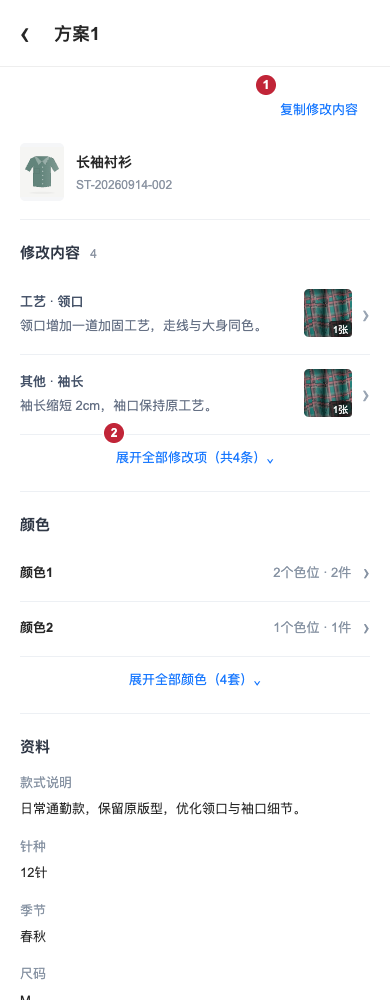

① 复制当前方案修改内容；② 修改项展开入口。

来源：样衣 Demo `order-mobile.html`，小程序方案查看页面。

<a id="req-007"></a>

#### REQ-007 复制修改内容（小程序-选样订单）

小程序订单列表和方案详情提供“复制修改内容”，一次仅复制当前方案中有文字的修改项。以下复制格式为两端共用规则，PC 端引用本条。

- 按工艺、面料、其他顺序分组，空组省略；其他配置类别有内容时排在上述类别之后。
- 每组从 1 重新编号，保持该类别内修改项的顺序。
- 有标签时使用“标签：修改文字”，无标签时直接写修改文字；保留原文字与换行。
- 不复制款号、方案名称、颜色、资料、备注或图片。
- 没有可复制文字时仅提示，不写入空内容。

格式示例：

```text
工艺说明：
1、领口：领口增加一道加固工艺，走线与大身同色。
2、下摆增加一道压线，保持平整。

其他说明：
1、袖长：袖长缩短 2cm，袖口保持原工艺。
```

- 剪贴板不可用或复制失败时，沿用现有失败提示规范，不提示复制成功，不改变原数据。
- 验收 AC-007-1：同一方案在小程序订单列表和方案详情复制所得文字一致，分组及编号符合上述规则。

<a id="req-008"></a>

#### REQ-008 方案查看（PC端-选样订单）

- 在现有订单表格和侧边详情中增加各样衣的方案摘要、入口及详情，支持查看指定方案。
- 详情展示实际保存的修改内容、颜色、尺码和资料，图片可预览。新旧订单均允许缺少方案或部分模块；无方案、模块或资料字段未填写时统一显示“未填写”，不补入默认内容。
- 修改内容与颜色列表默认显示两条，超过时可展开 / 收起，两条及以下不显示展开操作。
- 颜色可展开查看各色位明细；尺码在资料中展示。
- 当前样衣和方案标识清晰，切换方案后展示对应内容。订单修改规则沿用现有功能。
- 验收 AC-008-2：同一订单在 PC 端与小程序端的客户、样衣及方案业务内容一致；超过两条的列表可展开并收起。

**界面参考：PC 端方案查看**

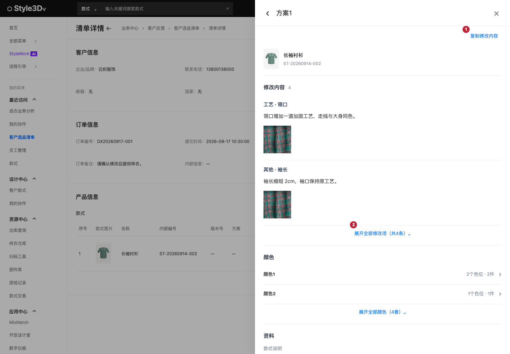

① 复制当前方案修改内容；② 修改项展开入口。

来源：样衣 Demo `order-pc.html`，PC 端方案查看页面。

<a id="req-009"></a>

#### REQ-009 复制修改内容（PC端-选样订单）

- 在订单表格及侧边方案详情提供“复制修改内容”，复制对象为当前选定方案。
- 复制范围、类别顺序、编号、标签、换行、空内容及失败处理全部沿用 REQ-007 的共用规则。
- 验收 AC-009-1：同一方案从 PC 端两个入口复制所得文字一致，且与小程序端相同。

<a id="req-010"></a>

#### REQ-010 修改内容配置

管理人员在配置页维护修改类别及其标签，供修改内容录入选择，沿用现有配置页的布局和操作结构。

- 支持维护修改类别及其所属标签；字段校验沿用现有规范。
- 更新后新录入使用最新配置；已保存方案及历史订单保留记录时的类别、标签，不被覆盖或清空。
- 配置允许删除，需二次确认；取消则保留，确认后新录入不再使用已删除配置，历史记录保留原内容。
- 验收 AC-010-2：取消删除不改变配置；确认删除后新录入不再提供该选项，历史方案的类别及标签仍可完整查看。

**分析共用规则（REQ-011～REQ-013）**

以下界面与交互为已确认需求。分析使用已有系统权限，不新增权限体系。Demo 中数值和日期均为演示，不能据此确定正式取数来源。

| 项目 | 规则 |
| --- | --- |
| 独立入口 | 选款分析、修改分析、颜色分析均可直接进入；查看单个客户的修改分析无需先进入选款分析 |
| 顶部筛选 | 统计周期、品类、款式、客户作用于当前页全部指标、图表与汇总；修改分析增加修改类别、修改标签。保持已有系统一行筛选结构，修改分析六项筛选及重置同排 |
| 多选关系 | 品类、款式、客户支持多选；同一维度内取并集，不同维度间取交集。修改类别与修改标签同理；类别约束可选标签，类别变化后移除不再适用的标签 |
| 周期 | 提供近7天、近30天、近90天，默认近30天；截图固定日期仅为演示，正式日期边界见待确认项 |
| 模块控制 | 排行指标、排行聚合维度、汇总聚合维度放到对应模块标题区。每个控制仅影响所属模块，不重置其他模块选择或汇总分页 |
| 分页 | 汇总表支持分页；改变该表自身维度、模式或顶部筛选时回到第一页；改变其他排行设置或趋势显隐时保留页码 |
| 空数据 | 指标显示0，图表与表格显示空状态，不保留上一范围结果；无分母时占比显示“—”，不出现 NaN、Infinity 或误导性的比例 |
| 命名 | 页面和表格统一使用“修改内容数量”；现有 Demo 修改汇总表中的“意见数量”是同一指标的旧文案，不定义另一个指标 |

**跨分析跳转**

1. 选款汇总支持按款式、品类、客户聚合。点击任一行的修改内容数量进入修改分析；点击整段原料与颜色摘要进入颜色分析。对应内容为0时显示普通文本，不提供无效跳转。
2. 跳转保留统计周期及其他维度筛选，将所点击行的款式、品类或客户写入目标页对应顶部筛选。目标筛选摘要、下拉勾选和“当前范围”必须一致，不叠加界面不可见的限制条件。
3. 进入目标后可继续改变任何筛选，不锁死来源范围。“清除范围”清空品类、款式、客户，保留周期及修改类别、标签；“重置”恢复近30天并清空当前页筛选。
4. 从汇总跳转时提供“返回选款分析”，恢复来源筛选、汇总维度、页码与滚动位置；直接进入目标页无需显示该返回入口。

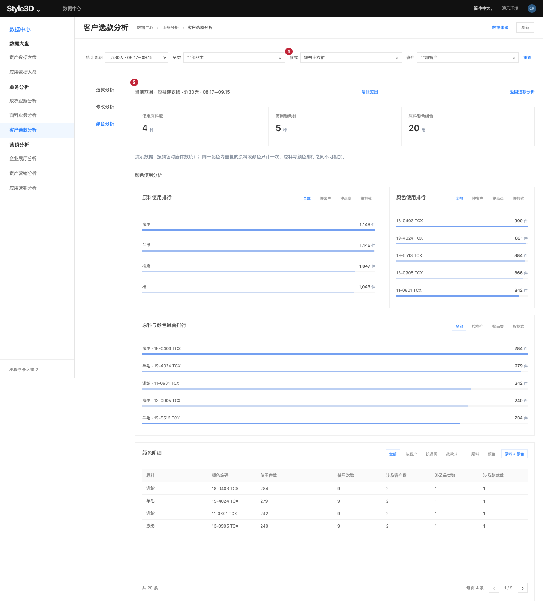

① 款式筛选回显所点击对象；② 当前范围、清除范围及返回选款分析。品类、客户的跳转采用同样逻辑。

来源：样衣 Demo `analytics.html`，选款分析 → 点击原料与颜色摘要。

<a id="req-011"></a>

#### REQ-011 选款分析

用于查看客户选款、二次打样和下单的变化，以及对应对象的修改与原料颜色情况。

| 模块 | 展示与交互 |
| --- | --- |
| 顶部指标 | 等宽展示选中次数（次）、二次打样次数（次）、下单数（单），不再展示选中率或修改次数卡片 |
| 周期趋势 | 默认同时显示三条线：选中次数蓝色、二次打样次数橙色、下单数绿色；共用时间轴与稳定的数值刻度 |
| 趋势图例 | 右上角为图例兼显隐开关，分别控制对应线，隐藏后图例置灰；可全部隐藏再恢复。切换筛选保留显隐选择，不改变排行、表格或指标 |
| 趋势提示 | 悬停或聚焦时间段时展示该段三项指标值及单位，即使某条线已隐藏也能查看对应值 |
| 排行 | 独立选择选中次数、二次打样次数或下单数，并独立选择按客户、品类、款式聚合；按当前指标从高到低展示，标题及单位随选择更新 |
| 汇总 | 紧接趋势与排行，独立选择按客户、品类、款式汇总；字段为对象、选中次数、二次打样次数、下单数、修改内容数量、原料与颜色、主要修改点 |
| 修改分析入口 | 汇总保留修改内容数量及主要修改点；不在本页重复设置修改分布或修改排行模块，点击数量到修改分析查看 |

**指标与摘要口径**

- 选中次数统计选中事件的次数；对应现有业务动作及去重规则待确认。二次打样次数按发起次数计，同一款式发起两次记2次，不按打样件数计。下单数单位为单，订单唯一性与跨款归属见待确认项。
- 修改内容数量按当前对象及顶部筛选下的修改记录去重计数。主要修改点展示主要标签及出现数量，便于快速了解修改方向。
- 原料与颜色展示为“4种原料 · 5种颜色 · 8种组合”这类文字摘要，三个值分别为原料、颜色编码、原料与颜色编码组合的去重数量。款式、品类、客户三种汇总均使用相同格式及跳转规则。
- 合计覆盖当前筛选范围的全部记录，不只计算当前分页；原料、颜色、组合按全范围分别去重，不能简单相加各行的种类数。下单总数跨款去重仍待正式业务规则确认。

- 验收 AC-011-1：默认三项指标和三条趋势同时可见，单位正确；隐藏二次打样线仅影响该线，其他指标、排行及汇总不变；可隐藏全部再恢复。
- 验收 AC-011-2：同一款式发起两次二次打样，纳入统计的次数为2；表格和所选排行指标与该口径一致，不使用打样件数替代。
- 验收 AC-011-3：汇总处于第2页时，切换排行为客户下单数，汇总维度及页码保持；切换汇总自身维度后回到第1页。
- 验收 AC-011-4：分别在款式、品类、客户汇总点击修改数量或原料与颜色摘要，目标页对应筛选与下拉勾选回显一致；修改目标筛选能生效，返回恢复来源状态。
- 验收 AC-011-5：两个对象使用相同原料和颜色组合，各行均计入该组合，全范围组合合计仅计1组；无相关内容时无可点击入口。

**界面参考：选款分析**

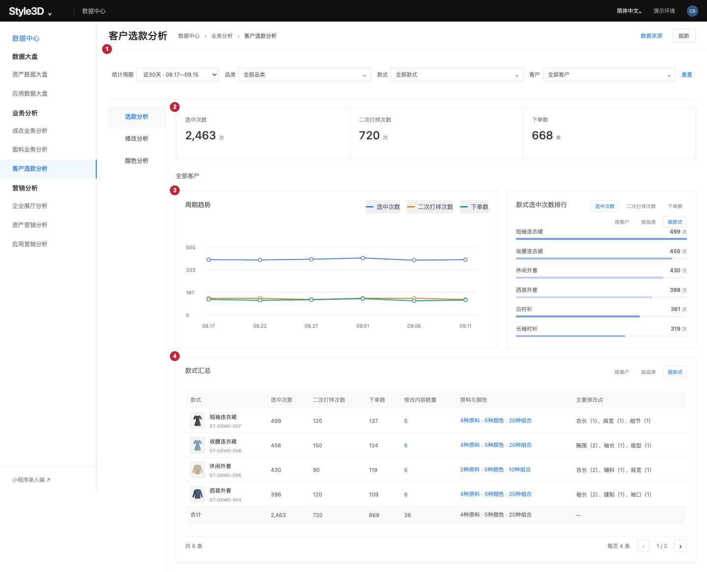

① 全页筛选；② 三项指标；③ 三条趋势与独立排行；④ 汇总维度及关联分析入口。

来源：样衣 Demo `analytics.html`，选款分析；示例数值不代表真实业务数据。

<a id="req-012"></a>

#### REQ-012 修改分析

集中分析修改内容的类别、标签与对象分布，支持直接选择单个客户查看，也承接选款汇总行的跳转。

| 模块 | 展示与交互 |
| --- | --- |
| 顶部筛选 | 周期、品类、款式、客户、修改类别、修改标签保持一行；选择客户后本页所有模块均限定该客户 |
| 指标 | 修改内容数量（条）、涉及客户数（个）、涉及款式数（款） |
| 分布 | 未限定单一修改类别时展示类别分布；选定一个类别后展示该类别的标签分布 |
| 排行 | 按修改内容数量排序，独立切换客户、品类、款式，不改变分布及下方汇总 |
| 汇总 | 固定按修改类别与标签汇总，列为修改类别、修改标签、修改内容数量、占比、涉及客户数、涉及款式数；不随排行切换成客户或款式表 |

修改内容数量按匹配的修改记录去重统计，不按标签个数累加；客户数、款式数分别去重。每个类别/标签行的占比为该行匹配的修改记录数 ÷ 当前全部筛选下的修改记录数。若历史记录含多个标签，同一记录可出现在多个标签行，总指标仍仅计一次，标签占比之和不保证为100%。无标签的记录保留为“未填写标签”，不丢失其数量。

类别与标签使用配置及历史记录中的实际值，不把 Demo 样例固定为业务枚举。截图中的“尺寸”等为历史演示类别，不代表新增独立尺寸模块；历史类别保留规则见 REQ-010。

- 验收 AC-012-1：直接进入修改分析选择一个客户，无需选款汇总跳转，三个指标、分布、排行与汇总均只包含该客户记录。
- 验收 AC-012-2：选中一个修改类别，分布切换为该类标签；改变类别后不可用的已选标签清除，下拉选项与筛选结果一致。
- 验收 AC-012-3：某范围有3条记录，其中2条含标签A、1条含标签B，数量分别为2、1，占比分别为66.7%、33.3%；若一条历史记录同时含A、B，总指标不重复累加，精度沿用系统规范。
- 验收 AC-012-4：切换排行聚合维度，固定类别/标签汇总及其页码不变；清除业务对象范围后，周期及修改类别、标签仍保留。
- 验收 AC-012-5：无匹配记录时指标为0，分布、排行、表格均显示空状态，没有遗留数据或非法占比。

**界面参考：修改分析**

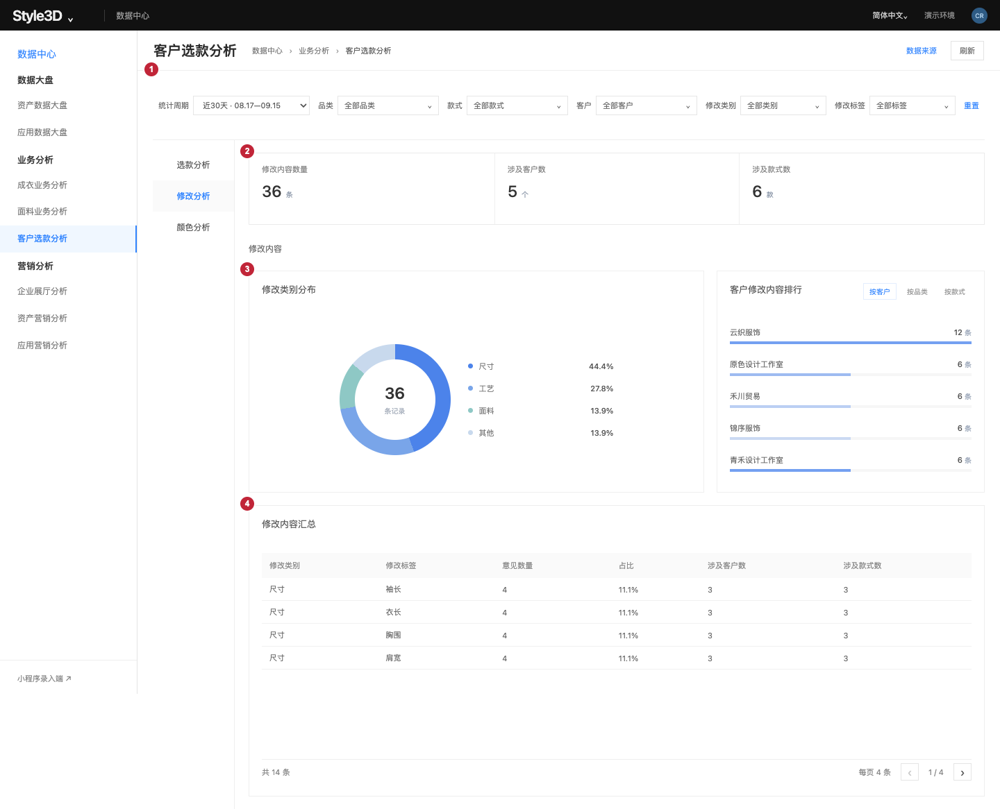

① 六项筛选同排；② 修改内容及涉及对象数；③ 分布与独立排行；④ 类别、标签汇总。图中“意见数量”按正文统一为“修改内容数量”。

来源：样衣 Demo `analytics.html`，修改分析；数据及历史类别仅作演示。

<a id="req-013"></a>

#### REQ-013 颜色分析

分析哪个原料用得多、哪个颜色用得多，以及哪个原料的哪个颜色用得多。功能名称统一为“颜色分析”。

| 术语 | 对应对象 | 计数含义 |
| --- | --- | --- |
| 配色记录 | 方案中的颜色1、颜色2等 | 每条有独立件数和多个色位，是使用次数的去重基础 |
| 色位 | 配色内A、B等位置 | 用于记录原料与颜色编码，不作为颜色种类数 |
| 原料 | 色位行的原料字段 | 当前范围不同原料的数量 |
| 颜色 | 色位行的颜色编码字段 | 当前范围不同颜色编码的数量，不是配色记录数或色位数 |
| 组合 | 原料 + 颜色编码 | 相同颜色编码配不同原料是不同组合 |

正式原料标识、文本同义词和编码规范化方式尚未确定，不将 Demo 的直接文本比较当作最终归并规则。

| 模块 | 展示与交互 |
| --- | --- |
| 顶部指标 | 使用原料数（种）、使用颜色数（种）、原料颜色组合（组）；各自在当前范围去重，不增加总件数卡片 |
| 原料排行 | 按原料使用件数降序，独立选择全部、按客户、按品类、按款式聚合 |
| 颜色排行 | 按颜色编码使用件数降序，独立选择上述聚合维度；名称显示具体颜色编码 |
| 组合排行 | 按原料与颜色组合的使用件数降序，名称同时显示原料及颜色编码，单独占一整行；独立选择聚合维度 |
| 颜色明细 | 独立选择原料、颜色、原料+颜色三种模式，同时独立选择全部、客户、品类、款式聚合；显示对象字段及使用件数、使用次数、涉及客户数、涉及品类数、涉及款式数 |

聚合为客户、品类、款式时，排行及明细按“所选维度对象 + 原料/编码/组合”分组，明确显示对象名称。单个排行变化不联动其他排行及明细，也不重置明细页码；明细自身模式或聚合变化回到第一页。不另设品类件数排行。

**使用件数与次数**

- 使用件数以每条配色记录对应的颜色件数加权，不使用手动覆盖后的样衣数量或订单总数量。
- 同一配色记录内，同一原料、同一颜色编码、同一组合在各自统计维度分别去重，再计入该配色件数；重复色位不重复乘算。不同配色记录分别计入。
- 使用次数为匹配该对象的不同配色记录数，不是色位出现次数；涉及客户、品类、款式按相应标识去重。
- 一条配色可能涉及多个原料和颜色，不同对象的使用件数可重叠；原料排行、颜色排行及组合排行之间不可相加。跨分组的汇总须重新按对应范围去重。
- 例：一条配色2件，A/B色位均为“棉 + 编码X”，则棉、X、棉+X各计2件、1次。再增加独立配色3件且同为棉+X，则分别为5件、2次；原料数、颜色数、组合数仍各为1。

- 验收 AC-013-1：按上述2件与3件的两条记录验证，重复色位不会变成4件或重复次数，三项种类指标均为1。
- 验收 AC-013-2：同一编码X分别用于棉和羊毛，颜色数为1、原料数为2、组合数为2；组合排行分别显示两种原料与编码。
- 验收 AC-013-3：原料排行切换按客户、颜色排行切换按品类，组合排行和明细保留原聚合方式及页码；明细切换模式后回到第一页。
- 验收 AC-013-4：从任一款式、品类、客户汇总进入，三项种类指标与来源行摘要一致；回显筛选可自由修改，清除范围不保留隐形限制。
- 验收 AC-013-5：仅修改外层样衣数量，不改变颜色记录件数时，使用件数不随之变化；无匹配颜色时三项指标为0，排行与明细显示空状态。

**界面参考：颜色分析**

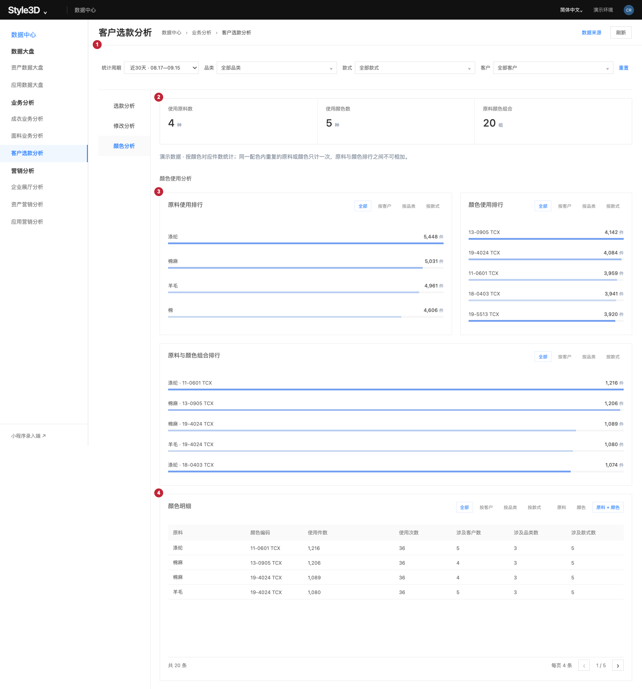

① 全页筛选；② 三项去重指标；③ 原料、颜色排行，下方为整行组合排行，各自独立切换聚合；④ 明细独立切换聚合与统计模式。

来源：样衣 Demo `analytics.html`，颜色分析；静态生成数据仅用于验证展示与交互。

**正式统计仍待确认的事项**

以下缺口影响正式数据开发，不阻塞已确认的页面交互评审，也不能由截图数值反推确定。

| 待确认事项 | 需明确的业务决定 |
| --- | --- |
| 三项指标来源 | 哪个现有动作或记录计为选中、二次打样、下单；重复操作去重方式，取消、删除、撤回如何冲回 |
| 订单计数 | 一单多款时各款及全范围的下单数如何归属、去重；客户、品类合计与各行之和的关系 |
| 数据纳入范围 | 暂存、正式订单及其他记录是否纳入修改和颜色分析；无方案的旧数据如何处理；各指标是否来自相同业务范围 |
| 时间与更新 | 统计使用哪个业务日期、时区、周期起止边界，更新频率及历史编辑后的重算方式 |
| 原料与颜色识别 | 原料是否关联已有主数据，名称同义词、大小写、空格及编码格式如何归并，历史自由文本如何映射 |
| 展示参数 | 趋势分段粒度、排行展示条数、并列排序与分页条数沿用已有系统的具体规则；Demo 数值不作为固定业务限制 |

当前 Demo 的静态数据、刷新后重置等演示机制不替代 REQ-001～REQ-010 中正式保存、暂存恢复与订单一致性要求。

**编号修正说明：**本版保留 REQ-001～REQ-013，修正 REQ-012、REQ-013 的锚点。旧 REQ-004～REQ-010 下误标为下一需求前缀的验收编号，统一改为所属 REQ 前缀，尾号及原验收内容保留；新增验收使用所属需求的未占用编号。
